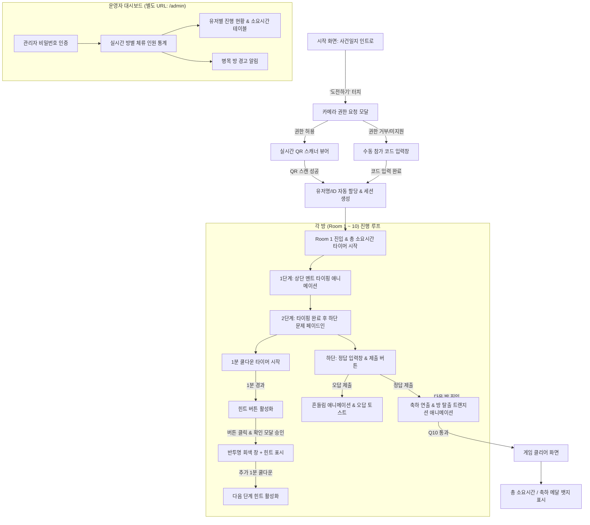
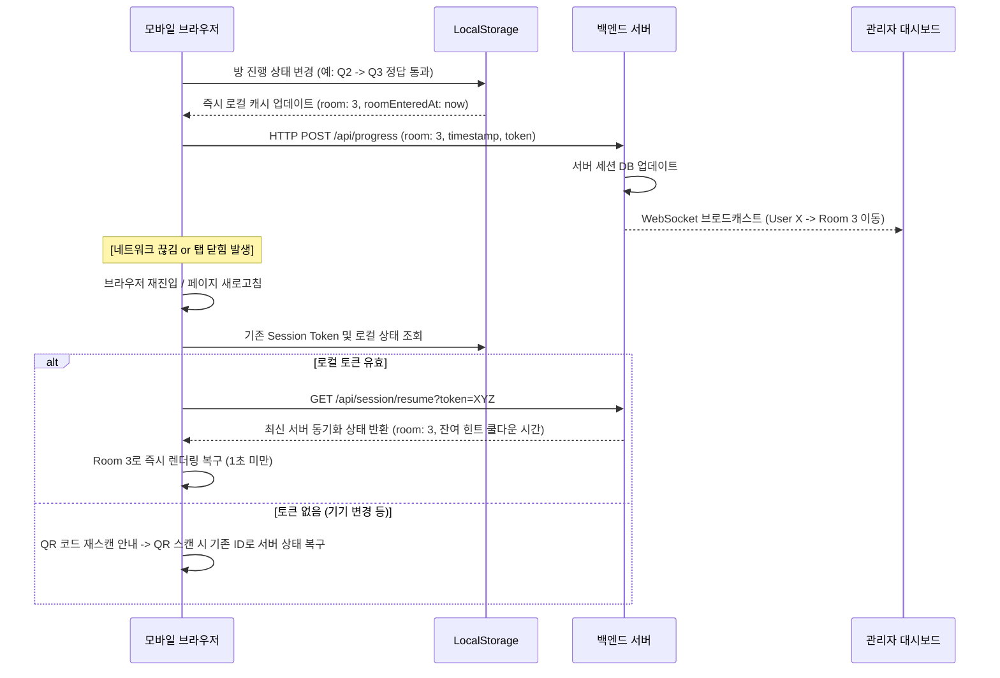

# [PRD] 모바일 방탈출 웹게임 제품 요구사항 정의서 (Product Requirements Document)

---

## 1. 프로젝트 개요 (Overview)

### 1.1 프로젝트 명칭
- **명탐정의 사건일지: 가인과 아벨 편 (Detective Case Log: Cain & Abel)**

### 1.2 기획 배경 및 목적
- 단체 행사(수련회, 캠프, 모임 등)에서 50명 이상의 참가자가 개인 모바일 기기를 활용하여 실시간으로 몰입감 있게 참여할 수 있는 웹 기반 인터랙티브 방탈출 게임 구축.
- 별도의 앱 다운로드나 회원가입 없이 **카메라 QR 코드 스캔 한 번으로 즉시 참가자 식별 및 게임 접속**.
- 네트워크 단절, 브라우저 이탈(전화 수신, 탭 닫힘) 등 현장 돌발 상황에서도 **진행 상태가 100% 무중단 복구**되는 높은 신뢰성의 게임 엔진 제공.
- 진행자는 **관리자 대시보드**를 통해 50+ 참가자의 방별 체류 현황과 병목 지점을 실시간 모니터링하여 원활한 행사 운영 지원.

### 1.3 핵심 지표 (Target Metrics)
- **동시 접속자(CCU)**: 최소 50명 ~ 최대 100명 무지연 처리
- **진행 복구 성공률**: 100% (재진입 시 방 번호, 타이머, 해금된 힌트 완전 복구)
- **진입 소요 시간**: QR 스캔 후 게임 시작까지 3초 이내

---

## 2. 사용자 여정 (User Journey & Flow)



---

## 3. 상세 기능 요구사항 (Functional Requirements)

### 3.1 시작 화면 및 QR 코드 인증 (Entry & QR Auth)

| 항목 | 상세 요구사항 |
| :--- | :--- |
| **화면 구성** | • `001.png` 이미지 기반의 사건일지 파일 폴더 디자인 적용.<br>• 중앙 메인 타이틀: "명탐정 XXX의 사건일지".<br>• 하단 메인 CTA 버튼: `[ 도전하기 ]`. |
| **카메라 권한 처리** | • 버튼 클릭 시 네이티브 카메라 접근 권한 (`navigator.mediaDevices.getUserMedia`) 요청.<br>• **iOS Safari / Android Chrome 권한 거부 대응 가이드**: 거부 시 설정 재설정 안내 팝업 노출.<br>• **Fallback**: 카메라 사용 불가 기기를 위해 `[참가 코드로 시작]` 수동 입력 텍스트 필드 제공. |
| **QR 코드 스캔 & 파싱** | • 모바일 후면 카메라 프리뷰 뷰파인더 렌더링 (화면 중앙 포커스 박스 및 가이드 선).<br>• QR 코드 인식 즉시 진동 피드백(Haptic, 지원 기기) 및 성공 음향(선택).<br>• **QR 페이로드 포맷 규격**: `DETECTIVE:{USER_ID}:{USER_NAME}` (예: `DETECTIVE:T01:조수_01`).<br>• 파싱된 정보를 통해 유저 고유 닉네임 자동 할당. |
| **세션 생성 및 시작** | • 클라이언트 `localStorage`에 `{ userId, userName, currentRoom: 1, startedAt: Timestamp }` 저장.<br>• 서버에 `USER_JOIN` 이벤트 발송 및 세션 등록.<br>• Room 1으로 화면 자동 전환. |

---

### 3.2 게임 플레이 화면 및 인터랙션 (Gameplay & UI/UX)

#### (1) 레이아웃 구성
- **상단 헤더**: 현재 방 번호(예: `CASE 01 / 10`), 누적 경과 시간 타이머(옵션 또는 미니 표시).
- **상단 멘트 영역**: 탐정의 수사 대사 텍스트가 표시되는 영역.
- **중앙 문제 영역**: 사건 증거물(종이 메모, 암호 격자 등 문제 이미지)이 표시되는 영역.
- **하단 컨트롤 바**: 
  - 좌측 상단: **힌트 버튼 (쿨다운 타이머 표시)**
  - 하단: **정답 입력 필드** + **[ 제출 ] 버튼**

#### (2) 단계별 순차 등장 연출 (Sequential Staging)
1. **상단 멘트 타이핑 효과 (Typewriter Effect)**:
   - 방 입장 즉시 텍스트가 한 글자씩 타이핑되며 등장 (타이핑 속도: 글자당 35~45ms).
   - 타자기 타격 사운드 효과(옵션, 기본 Mute).
   - 사용자 편의성: 타이핑 도중 화면을 탭하면 즉시 전체 멘트가 완성되는 **스킵(Skip) 기능** 지원.
2. **하단 문제 페이드인 (Fade-In Motion)**:
   - 상단 멘트 타이핑이 완료되는 즉시, 하단 문제 영역이 `opacity: 0 -> 1` 및 `translateY: 20px -> 0px`로 부드럽게 슬라이드 업 페이드인(0.6초 지속).
   - 모바일 환경을 고려하여 문제 이미지를 탭하면 화면 전체로 볼 수 있는 **이미지 라이트박스(확대 보기) 기능** 지원.

#### (3) 정답 입력 및 검증 (Answer Verification)
- **입력 필드 UX**:
  - 영문 입력 시 자동 대문자 변환(Uppercase 자동 적용).
  - 앞뒤 불필요한 공백 자동 제거(Trim).
  - 숫자/영문 전용 키패드 힌트 설정 (`inputMode="text"`, `autoCapitalize="characters"`).
- **정답 판정**:
  - **오답 제출 시**: 입력창 좌우 흔들림(Shake) 애니메이션(0.4초) + 붉은색 테두리 + "틀렸습니다. 단서를 다시 확인해보세요." 토스트 메시지.
  - **정답 제출 시**: 녹색 하이라이트 + 통과 효과음 + **다음 방 전환 애니메이션**.
- **방 탈출 트랜지션 애니메이션 (Room Transition Motion)**:
  - 현재 방 화면이 좌측으로 슬라이드 아웃되며, 수사 파일이 넘어가는 모션(Page turn / Slide motion, 0.5초)으로 다음 방 로딩.
  - 다음 방 입장 시 즉시 다음 멘트 타이핑 시퀀스 실행.

---

### 3.3 다단계 힌트 시스템 (Multi-Tier Hint System)

```
[ 방 입장 (0초) ] 
       ↓ 
[ 힌트 버튼 비활성화 (버튼 텍스트: "힌트 (60s)") ] 
       ↓ 1분 경과
[ 힌트 버튼 활성화 (버튼 텍스트: "💡 힌트 1 열람 가능") ] 
       ↓ 사용자 터치
[ 확인 팝업 모달: "힌트를 확인하시겠습니까?" ] 
       ↓ 확인 클릭
[ 반투명 회색 배경 (Dimmed Modal) + 힌트 1 내용 표시 ]
       ↓ 닫기 후 다음 힌트 타이머 가동
[ 힌트 버튼 재비활성화 (버튼 텍스트: "다음 힌트 (60s)") ]
       ↓ 추가 1분 경과
[ 💡 힌트 2 활성화 ]
```

| 구분 | 규칙 및 명세 |
| :--- | :--- |
| **버튼 위치** | 정답 입력창 좌측 바로 위 (`position: absolute` or flex 상단 배치). |
| **초기 상태** | 방 입장 시 **비활성화(Disabled)**. 버튼 내부에 1분 잔여 카운트다운 표시 (`60s` -> `0s`). |
| **활성화 조건** | 해당 방 입장 후 **정확히 60초 경과 시** 활성화 (`cursor: pointer`, 옐로우/골드 발광 효과). |
| **확인 다이얼로그** | 활성 버튼 클릭 시 즉시 힌트가 나오지 않고 **"힌트를 확인하시겠습니까? (현재 1/3단계)"** 확인 모달 호출. |
| **힌트 표출 UI** | 모달 승인 시, 화면 전체에 **반투명 회색 창(`rgba(0,0,0,0.7)`) 딤드 처리** 후 탐정 수사 수첩 형태의 카드 안에 힌트 텍스트 노출. 닫기(`X`) 버튼 제공. |
| **다단계 힌트 연쇄** | 힌트 1을 열람한 후, 힌트 2를 보기 위해서는 **추가로 1분(60초)의 쿨다운**을 대기해야 함. (연속 열람 방지) |
| **타이머 영속성** | 새로고침을 하거나 페이지를 나갔다 와도 로컬/서버의 `roomEnteredAt` 및 `lastHintUnlockedAt` 기준으로 잔여 시간을 계산하여 타이머 우회 차단. |

---

### 3.4 클리어 화면 (Game Clear / Celebration)

- **배경 및 그래픽**: `012.png`의 골드 십자가 앰블럼/메달 배경 적용.
- **메인 축하 문구**: 
  > **"축하드립니다!"**  
  > **카톡 방탈출 시리즈 '가인과 아벨'을 클리어 하셨습니다!**
- **기록 요약 카드 (Result Card)**:
  - 플레이어: **`{유저명}`**
  - 총 소요 시간: **`00시간 28분 42초`**
  - 사용한 힌트 총 개수: **`{힌트 수}개`**
  - 클리어 순위: **`전체 참가자 중 N번째 탈출 성공!`** (관리자 서버 연동 실시간 등수)
- **공유 기능**: 클리어 결과 카드 이미지 다운로드 또는 결과 복사 기능 제공.

---

### 3.5 관리자 대시보드 (Admin Dashboard)

- **접근 경로**: `/admin` (플레이 화면과 완전 분리된 독립 라우트).
- **접근 보안**: 관리자 패스코드(PIN) 인증 기반 접근 제어.
- **주요 기능 명세**:
  1. **실시간 핵심 지표 카드**:
     - 총 등록 참가자 수 / 현재 활성 세션(Active CCU)
     - 총 클리어 인원 수 / 평균 소요 시간
  2. **각 방별 실시간 체류 인원 통계 (Room Distribution Heatmap/Chart)**:
     - Room 1 ~ Room 10 및 클리어(Clear) 방까지의 인원수 분포 바 차트.
     - **병목 방 하이라이트**: 참가자가 10명 이상 몰려있거나 평균 체류 시간이 10분을 초과하는 방에 붉은색 경고 표시.
  3. **전체 참가자 실시간 모니터링 테이블**:
     - 컬럼: `유저명(QR코드 ID)` | `현재 방` | `현재 방 체류시간` | `총 누적시간` | `사용 힌트 수` | `네트워크 상태(접속중/오프라인)` | `관리자 액션`
     - 정렬: 현재 방 높은 순, 소요 시간 순, 이름 순.
  4. **운영 지원 긴급 제어 액션 (Admin Controls)**:
     - 특정 유저 강제 다음 방 이동 (장기 정체자 구제용)
     - 특정 방 힌트 일괄 개방
     - 참가자 진행 상태 초기화 (재시작 지원)
  5. **데이터 실시간 갱신**:
     - WebSocket 또는 Server-Sent Events (SSE) 기반 실시간 푸시 (네트워크 이슈 시 3초 주기 Fallback Polling).

---

## 4. 데이터 보존 및 무중단 세션 전략 (Resilience & State Persistence)

50명 이상의 유저가 모바일 환경(LTE <-> Wi-Fi 전환, 백그라운드 전환, 전화 수신, 브라우저 실수로 닫기 등)에서 플레이하므로 무중단 상태 복구가 최우선 요구사항입니다.



### 상태 보존 핵심 메커니즘
1. **Local-First Caching**:
   - 모든 진행 상태(현재 방 번호, 해당 방 입장 시각, 열람한 힌트 인덱스 목록, 게임 시작 시각)를 변경 즉시 `localStorage`에 암호화/직렬화하여 저장.
2. **Server Dual-Write**:
   - 방 클리어, 힌트 열람 등의 액션 발생 시 백엔드 API로 비동기 동기화.
   - 네트워크 오프라인 시 로컬 큐에 적재 후 네트워크 재연결 감지 시 자동 재전송.
3. **Heartbeat & Status Polling**:
   - 클라이언트에서 10~15초 주기로 서버에 가벼운 핑(Heartbeat)을 전송하여 관리자 대시보드에 '온라인/오프라인' 상태 반영.

---

## 5. 방탈출 문제 및 다단계 힌트 데이터베이스 (Q1 ~ Q10)

제공된 `2026 교친다 방탈출 해설.pdf` 및 이미지 자료를 분석하여 구축한 전체 10개 방의 공식 문제 및 힌트 명세입니다.

```
정답 검증 공통 규칙:
- 영문은 대소문자 구분 없음 (자동 toUpperCase() 변환 후 검증)
- 공백 제거 후 검증 (자동 replace(/\s+/g, '') 처리)
```

---

### [Room 01] 사건의 발단 (Q1)
*   **상단 멘트 (타이핑)**:
    > "이봐, 한가한 소리를 할 때가 아니야.  
    > 살인사건이 나버렸다고!  
    > 지금 당장 도움이 필요해. 와줄 수 있지?"
*   **하단 문제 문구**: "시공간 어플리케이션의 암호는? (영어 대문자 6자리)"
*   **해설 및 풀이 원리**:
    - 2행 3열의 격자판에 선들이 그려져 있음.
    - 붉은 선이 그어져 있지 않은 회색 빈 선 부분들 위로 선을 그리면 영어 알파벳 6글자가 도출됨.
*   **다단계 힌트**:
    - **힌트 1 (1분 경과)**: "검은색(붉은색)으로 이미 그어져 있는 선 대신, 비어있는 칸의 회색 선들을 유심히 살펴보세요."
    - **힌트 2 (2분 경과)**: "선이 비어있는 부분들을 펜으로 연결해 보면 익숙한 영어 단어가 나타납니다. 첫 번째 글자는 'L'입니다."
    - **힌트 3 (3분 경과)**: "빈 선들을 채우면 순서대로 L, E, T, S, G, O 가 완성됩니다."
*   **정답**: **`LETSGO`**

---

### [Room 02] 탐정의 시험 (Q2)
*   **상단 멘트 (타이핑)**:
    > "오늘은 친히 내가 탐정을 해주지. 너는 탐정 조수로서 날 도와야해.  
    > 탐정 조수도 어려운 직업이라고? 이정도 문제는 기본이겠지?"
*   **하단 문제 문구**: "탐정이 내민 문제의 답은? (숫자 4자리)"
*   **문제 본문 내용**:
    > **To. 조수**  
    > 탐정에게 가장 중요한 키워드는 **공**정성.  
    > **사**건을 마주했을 때, 눈 앞의 증거와 현장을 꼼꼼히 살펴야 하지.  
    > 그리고 그 안에서 서로를 연결하는 **공**통점을 찾아내는 것.  
    > 조수, 내용을 숙지했다면 **이**제 현장으로 와.
*   **해설 및 풀이 원리**:
    - 조수에게 보낸 편지 속에서 숫자를 나타내는 한국어 발음 글자 4개를 추출 (공, 사, 공, 이).
*   **다단계 힌트**:
    - **힌트 1 (1분 경과)**: "편지 본문에서 붉은 동그라미로 강조된 글자들을 찾아보세요."
    - **힌트 2 (2분 경과)**: "글자들을 소리 내어 읽어보면 숫자의 발음과 동일합니다. (예: 공 = 0)"
    - **힌트 3 (3분 경과)**: "'공'정성(0), '사'건(4), '공'통점(0), '이'제(2)를 순서대로 조합하세요."
*   **정답**: **`0402`**

---

### [Room 03] 첫 번째 사건 현장 (Q3)
*   **상단 멘트 (타이핑)**:
    > "뭐, 이정도는 풀 줄 알았어. 여긴 첫번째 사건 현장이야.  
    > 누군가 증거인멸을 해놓은 것 같군. 그러나 힌트가 있을 거야."
*   **하단 문제 문구**: "자세히 보면 무언가 보이는 것 같다. 무엇일까? (영어 대문자 6자리)"
*   **제시 단서**: 돋보기 아래에 적힌 숫자 `3  31  18  5  27  12`
*   **해설 및 풀이 원리**:
    - 숫자는 알파벳 순서(A=1 ~ Z=26).
    - 26을 초과하는 숫자는 Z 다음 다시 A부터 순환 계산 (A=27, B=28...).
    - 3=C, 31(26+5)=E, 18=R, 5=E, 27(26+1)=A, 12=L.
*   **다단계 힌트**:
    - **힌트 1 (1분 경과)**: "숫자는 알파벳의 순번(A=1, B=2, C=3...)을 의미합니다."
    - **힌트 2 (2분 경과)**: "알파벳은 26개(Z=26)입니다. 26이 넘는 숫자는 Z 다음 다시 A(27)부터 세어보세요."
    - **힌트 3 (3분 경과)**: "3=C, 31=26+5(E), 18=R, 5=E, 27=26+1(A), 12=L 입니다."
*   **정답**: **`CEREAL`**

---

### [Room 04] 들판의 목격자 (Q4)
*   **상단 멘트 (타이핑)**:
    > "시리얼? 웬 시리얼이 있지? 흠, 사건이 미궁으로 흐르는군.  
    > 두번째 현장은 이 들판이야. 근데 누군가 소리치고 있잖아?"
*   **하단 문제 문구**: "소리치는 사람이 누구인가? (영어 대문자 4자리)"
*   **제시 단서**:
    - 우물 정(#)자 격자:
      `L(•) | N | S`  
      ` •E  | W | A•`  
      `  D  | O(•)| R`
    - 소리치는 사람의 말풍선 기호: `ᒧ   匚•   ᑌ   ᆨ`
*   **해설 및 풀이 원리**:
    - 피그펜 암호(Pigpen cipher) 원리.
    - 테두리 선의 꺾임 형태와 점(•)의 위치를 대조하여 알파벳 매칭.
    - `ᒧ` = L, `匚•` = A, `ᑌ` = N, `ᆨ` = D.
*   **다단계 힌트**:
    - **힌트 1 (1분 경과)**: "말풍선 속 도형 기호들은 상단 9칸 격자판의 테두리 모양과 점의 유무를 의미합니다."
    - **힌트 2 (2분 경과)**: "왼쪽 아래 꺾쇠 모양 `ᒧ`은 L이 있는 칸의 테두리 모양입니다."
    - **힌트 3 (3분 경과)**: "`ᒧ`=L, `匚•`=A, `ᑌ`=N, `ᆨ`=D 순서대로 읽어보세요."
*   **정답**: **`LAND`**

---

### [Room 05] 범행 동기 (Q5)
*   **상단 멘트 (타이핑)**:
    > "랜드씨의 증언으로 용의자를 추렸어. 이 근처 영농후계자 녀석이군.  
    > 하지만, 왜 그랬는지가 문제란 말이야. 추리의 기본은 'Why Done it' 아니겠어?"
*   **하단 문제 문구**: "왜 그런 짓을 벌인걸까? (영어 대문자 4자리)"
*   **제시 단서**: 4개의 칸에 흩어진 파랑, 주황, 초록, 보라 선들.  
    힌트 색상 순서: `[파랑] [주황] [초록] [보라]`
*   **해설 및 풀이 원리**:
    - 각 칸에 흩어져 있는 동일한 색깔의 선들을 한 사각형 안에 겹치면 알파벳이 완성됨.
    - 파랑 = E, 주황 = N, 초록 = V, 보라 = Y.
*   **다단계 힌트**:
    - **힌트 1 (1분 경과)**: "4개의 네모 칸 안에 흩어져 있는 '같은 색깔의 선'들을 눈으로 한 곳에 합쳐보세요."
    - **힌트 2 (2분 경과)**: "하단에 제시된 색상 순서(파랑 -> 주황 -> 초록 -> 보라)대로 글자를 배열하세요."
    - **힌트 3 (3분 경과)**: "파란 선을 합치면 'E', 주황 선은 'N', 초록 선은 'V', 보라 선은 'Y'가 됩니다."
*   **정답**: **`ENVY`**

---

### [Room 06] 잊어버린 본분 (Q6)
*   **상단 멘트 (타이핑)**:
    > "이봐, 질투 때문이라고? 질투가 형제를 죽일 정도란 말이야?  
    > 너에겐 원래의 역할이 있었잖아! 왜 그걸 잊어버린 거지?"
*   **하단 문제 문구**: "원래 그의 역할은 무엇이었을까? (영어 대문자 6자리)"
*   **제시 단서**:
    ```
    DTQVJGT  >>   BROTHER
    SPMF     >    ROLE
    NHHSHU   >>>  ?
    ```
*   **해설 및 풀이 원리**:
    - 카이사르 암호(역방향 시프트). 화살표(`>`) 개수만큼 알파벳을 이전 순서로 이동.
    - `D >> B` (2칸 앞), `S > R` (1칸 앞).
    - `NHHSHU >>> ?` (3칸 앞씩 이동):
      N-3=K, H-3=E, H-3=E, S-3=P, H-3=E, U-3=R -> `KEEPER`.
*   **다단계 힌트**:
    - **힌트 1 (1분 경과)**: "오른쪽 화살표(`>`)의 개수는 알파벳을 몇 칸 앞선 순서로 바꿀지를 뜻합니다."
    - **힌트 2 (2분 경과)**: "D에서 2칸 앞 알파벳은 B입니다. 세 번째 단어는 화살표가 3개(`>>>`)이므로 각 글자에서 3칸씩 앞의 알파벳을 찾으세요."
    - **힌트 3 (3분 경과)**: "N에서 3칸 앞은 K, H에서 3칸 앞은 E... 단어를 완성하면 '지키는 자'라는 뜻의 단어가 됩니다."
*   **정답**: **`KEEPER`**

---

### [Room 07] 처벌 수위 (Q7)
*   **상단 멘트 (타이핑)**:
    > "잡았어. 범인의 이름은 가인. 원래 그 동생을 지켜야하는 자(Keeper)야.  
    > 응? 처벌을 해야하는 거 아니냐고? 물론 그렇지.  
    > 근데 원래 이런 건, 잡는 것보다 처벌 수위가 문제란 말이야."
*   **하단 문제 문구**: "그의 처벌 수위는 무엇일까? (숫자 6자리)"
*   **제시 단서**: 크기가 다른 다양한 색상의 화살표들.  
    힌트 색상 점: `[노랑] [빨강] [초록] [파랑] [분홍] [보라]`
*   **해설 및 풀이 원리**:
    - 동일 색상의 화살표를 '가장 큰 사이즈 -> 중간 -> 가장 작은 사이즈' 순서로 화살표 방향을 따라 선을 그리면 숫자가 형성됨.
    - 노랑=2, 빨강=0, 초록=1, 파랑=6, 분홍=5, 보라=7.
*   **다단계 힌트**:
    - **힌트 1 (1분 경과)**: "색깔별로 화살표들을 묶어보세요. 각 색깔마다 크기가 큰 화살표부터 작은 화살표까지 존재합니다."
    - **힌트 2 (2분 경과)**: "같은 색깔 내에서 '가장 큰 화살표부터 작은 화살표 순서대로' 방향을 따라 선을 이어 그리면 숫자가 그려집니다."
    - **힌트 3 (3분 경과)**: "노랑(2), 빨강(0), 초록(1), 파랑(6), 분홍(5), 보라(7) 순서대로 숫자를 나열하세요."
*   **정답**: **`201657`**

---

### [Room 08] 주머니 속 단서 (Q8)
*   **상단 멘트 (타이핑)**:
    > "징역 201657년 급의 저주로군! 이거 봐. 피의자가 벌써 두려워하는군.  
    > 어쩔 수 없지. 이걸 가져다 주라고."
*   **하단 문제 문구**: "탐정이 가져다 주라고 한 물건은? (영어 대문자 4자리)"
*   **제시 단서**: 가죽 주머니 속에 그려진 동물 얼굴 아이콘 (원숭이, 고양이, 호랑이, 상어).  
    일부 동물 아이콘에 노란색 색칠이 칠해져 있음.
*   **해설 및 풀이 원리**:
    - 동물 영어 단어의 스펠링 글자 수만큼 주머니에 아이콘이 있고, 색칠된 순번의 알파벳을 추출.
    - 원숭이: `MONKEY` (6글자 중 1번째 색칠) -> `M`
    - 고양이: `CAT` (3글자 중 2번째 색칠) -> `A`
    - 호랑이: `TIGER` (5글자 중 5번째 색칠) -> `R`
    - 상어: `SHARK` (5글자 중 5번째 색칠) -> `K`
*   **다단계 힌트**:
    - **힌트 1 (1분 경과)**: "주머니 속 동물들의 영어 단어(MONKEY, CAT, TIGER, SHARK)를 적어보세요."
    - **힌트 2 (2분 경과)**: "동물들 중 노란색으로 칠해진 얼굴이 몇 번째에 위치하는지 세어보세요. 그 번호가 영어 스펠링의 위치입니다."
    - **힌트 3 (3분 경과)**: "원숭이 1번째=M, 고양이 2번째=A, 호랑이 5번째=R, 상어 5번째=K"
*   **정답**: **`MARK`**

---

### [Room 09] 살인자를 지켜주는 표 (Q9)
*   **상단 멘트 (타이핑)**:
    > "이게 뭐냐고? 아, '표(mark)'라는 거야. 이게 있으면 가인을 아무도 죽일 수 없지.  
    > 응? 왜 살인자를 봐주냐고? ...아, 엄밀히 말하면 봐주는 건 아니지만."
*   **하단 문제 문구**: "왜 살인자를 봐주는 걸까? (숫자 4자리)"
*   **제시 단서**:
    - 윗줄 패턴 4개 = `6753` (점이 있는 칸만 대각선이 지나가며 숫자를 형성)
    - 아랫줄 패턴 4개 = `?`
*   **해설 및 풀이 원리**:
    - 점이 없는 칸은 지나갈 수 없고, 점이 있는 칸만 대각선으로 통과하여 선을 이으면 숫자가 나타남.
    - 아랫줄 4개 칸의 선을 이으면 순서대로 `1`, `2`, `2`, `4`가 됨.
*   **다단계 힌트**:
    - **힌트 1 (1분 경과)**: "윗줄 예시(6753)의 붉은 대각선들이 어떤 칸을 지나가는지 보세요. 점이 찍힌 칸만 통과합니다."
    - **힌트 2 (2분 경과)**: "아랫줄에서도 점이 있는 칸들만 연결하여 대각선 선을 그어보면 아라비아 숫자가 나타납니다."
    - **힌트 3 (3분 경과)**: "첫 번째 칸은 1, 두 번째와 세 번째 칸은 2, 네 번째 칸은 4의 형태가 됩니다."
*   **정답**: **`1224`**

---

### [Room 10] 탐정의 정체 (Q10)
*   **상단 멘트 (타이핑)**:
    > "그래. 히브리서 12장 24절. 아벨의 피는 '고소하는 피'이지만,  
    > 어떤 피는 '더 나은 일'을 하기도 하거든. 지금처럼 죄를 '덮어주는 피' 말이야.  
    > 올해도 수고했어. 탐정 조수. 아, '내 이름'이 뭔지는 이미 눈치챘지?"
*   **하단 문제 문구**: "탐정의 진짜 이름은? (영어 대문자 5자리)"  
    *(PDF 원본의 인쇄 오류인 '소리치는 사람이 누구인가?' 문구를 대사 맥락에 맞게 '탐정의 진짜 이름은?'으로 명확히 수정)*
*   **제시 단서**: 0과 1로 빼곡히 채워진 7행 22열의 숫자 매트릭스.
*   **해설 및 풀이 원리**:
    - 상하좌우 테두리 0 가이드라인을 출발하여, 벽 역할을 하는 1을 피해 0들로만 길을 이으면 5개의 알파벳이 완성됨.
    - 연결된 글자: `J E S U S`
*   **다단계 힌트**:
    - **힌트 1 (1분 경과)**: "탐정의 마지막 멘트('내 이름이 뭔지는 이미 눈치챘지?')와 히브리서 말씀의 '더 나은 피'를 묵상해보세요."
    - **힌트 2 (2분 경과)**: "숫자 1은 지나갈 수 없는 벽입니다. 0으로만 이루어진 길을 따라 선을 그어보세요."
    - **힌트 3 (3분 경과)**: "0을 따라 선을 그으면 나타나는 5글자 영문 이름은 J-E-S-U-S 입니다."
*   **정답**: **`JESUS`**

---

## 6. 기술 아키텍처 및 시스템 사양 (Technical Architecture)

```
[ Client: Mobile Web ]
  ├── View: React / Next.js (Mobile-first Responsive SPA)
  ├── Motion: Framer Motion (Typewriter, Fade-in, Room Slide Transition)
  ├── QR Reader: html5-qrcode (Camera stream parser)
  └── Local Storage Cache (Zero-data-loss state persistence)
         ▲
         │ WebSocket (실시간 세션) + HTTPS (REST API)
         ▼
[ Server: Node.js (Express / Fastify) ]
  ├── Session Manager (In-memory + SQLite / Redis)
  ├── Answer Validator (Case/Space Sanitization)
  ├── Hint Cooldown Clock (Server-side authoritative timer)
  └── Admin Broadcaster (Socket.io / SSE room updates)
         ▲
         │ 실시간 동기화
         ▼
[ Admin Dashboard: /admin ]
  ├── Real-time Chart (Room 1~10 distribution)
  ├── User Status Table (CCU 50+ live status)
  └── Emergency Override Controls
```

### 6.1 프론트엔드 상세 규격
1. **프레임워크**: React (Next.js 14 App Router 또는 Vite + React SPA)
2. **모바일 뷰포트 최적화**:
   - `viewport: width=device-width, initial-scale=1.0, maximum-scale=1.0, user-scalable=no`
   - 모바일 사파리 하단 네비게이션 바(100vh 이슈) 대응: `100dvh` (Dynamic Viewport Height) 활용
   - 더블 탭 확대 방지 (`touch-action: manipulation`)
3. **애니메이션 & 인터랙션**:
   - `Framer Motion`: 타이핑 커서 깜빡임, 문제 등장 슬라이드업, 방 전환 수사일지 모션
   - `Canvas-confetti`: 엔딩 클리어 시 축하 폭죽 효과

### 6.2 백엔드 및 실시간 통신 규격
1. **서버 런타임**: Node.js (TypeScript) + Fastify/Express
2. **실시간 통신 프로토콜**:
   - **WebSocket (Socket.io)** 또는 **Server-Sent Events (SSE)**
   - 플레이어는 상태 변경 시마다 서버에 REST POST (`/api/game/progress`) 또는 소켓 emit
   - 서버는 변경 내역을 관리자 대시보드 룸(`admin-room`)으로 즉시 브로드캐스트
3. **동시성 50인 부하 고려**:
   - 50명 동시 액션은 경량 Node.js 싱글 프로세스로도 CPU 1% 미만으로 처리 가능.
   - 단, 동시 접속 시 WebSocket 핸드셰이크 실패 대비 **HTTP Short Polling(3초 주기) Fallback** 내장.

### 6.3 QR 코드 규격 및 생성 가이드
- 참가자 50인에게 사전 인쇄되어 배포될 QR 코드 형식:
  - 포맷: 텍스트 또는 JSON 포맷
  - 권장 포맷: `DETECTIVE:USER_{01~50}:{팀명 또는 번호}` (예: `DETECTIVE:USER_07:7조_명탐정`)
  - 웹 접속 URL 형태의 QR도 지원: `https://{domain}/?code=USER_07` (스캔 즉시 브라우저로 열리며 자동 로그인되는 하이브리드 지원)

---

## 7. 화면 설계 및 와이어프레임 (UI/UX Wireframes)

### 7.1 메인 게임 플레이 화면 (모바일 390 x 844 px)

```
┌───────────────────────────────────────┐
│ [CASE 03 / 10]             ⏱️ 08:24   │ <- 상단 방 번호 및 누적 시간
├───────────────────────────────────────┤
│                                       │
│ ┌───────────────────────────────────┐ │
│ │ 💬 탐정의 수사 메모                │ │
│ │ "뭐, 이정도는 풀 줄 알았어.       │ │ <- Step 1: 한 글자씩 타이핑
│ │  여긴 첫번째 사건 현장이야..."     │ │
│ └───────────────────────────────────┘ │
│                                       │
│ ┌───────────────────────────────────┐ │
│ │ 🔍 단서 및 문제 이미지            │ │
│ │                                   │ │ <- Step 2: 페이드인 등장
│ │    [ 3  31  18  5  27  12 ]       │ │    (탭 시 전체화면 확대)
│ │                                   │ │
│ │ "자세히 보면 무언가 보이는 것     │ │
│ │  같다. 무엇일까? (대문자 6자리)"   │ │
│ └───────────────────────────────────┘ │
│                                       │
│ [💡 힌트 (00:34)]                      │ <- 입력창 좌측 위 (1분 쿨다운)
│ ┌─────────────────────────┬─────────┐ │
│ │ 정답을 입력하세요       │ [제출]  │ │ <- 하단 고정 컨트롤 바
│ └─────────────────────────┴─────────┘ │
└───────────────────────────────────────┘
```

### 7.2 힌트 열람 모달 (반투명 딤드 레이어)

```
┌───────────────────────────────────────┐
│░░░░░░░░░░░░░░░░░░░░░░░░░░░░░░░░░░░░░░░│
│░░░░░┌───────────────────────────┐░░░░░│
│░░░░░│ 💡 탐정의 힌트 (1 / 3)   [X]│░░░░░│ <- 상단 닫기 버튼
│░░░░░├───────────────────────────┤░░░░░│
│░░░░░│                           │░░░░░│
│░░░░░│ "숫자는 알파벳의 순번     │░░░░░│ <- 힌트 내용
│░░░░░│  (A=1, B=2...)을 의미      │░░░░░│
│░░░░░│  합니다."                 │░░░░░│
│░░░░░│                           │░░░░░│
│░░░░░│ ⏱️ 다음 힌트: 00:58 후 해금 │░░░░░│
│░░░░░└───────────────────────────┘░░░░░│
│░░░░░░░░░░░░░░░░░░░░░░░░░░░░░░░░░░░░░░░│
└───────────────────────────────────────┘
```

### 7.3 관리자 대시보드 화면 (`/admin`)

```
┌────────────────────────────────────────────────────────────────────────┐
│ 🕵️ 명탐정 방탈출 실시간 관제 대시보드                   [새로고침] [전체 초기화]│
├────────────────────────────────────────────────────────────────────────┤
│ [총 참가자: 52명]   [현재 접속중: 49명]   [클리어: 12명]   [평균시간: 24분]│
├────────────────────────────────────────────────────────────────────────┤
│ 📊 방별 체류 인원 통계 (실시간 분포)                                     │
│  Q1: ██ (4명)                                                          │
│  Q2: █ (2명)                                                           │
│  Q3: █████ (11명)  ⚠️ 병목 발생 (평균 체류시간 9분)                    │
│  Q4: ███ (6명)                                                         │
│  Q5: ████ (8명)                                                        │
│  Q6: █ (2명)                                                           │
│  Q7: ██ (4명)                                                          │
│  Q8: █ (1명)                                                           │
│  Q9: █ (1명)                                                           │
│ Q10: █ (2명)                                                           │
│ CLEAR: ██████ (12명) 🏆                                                │
├────────────────────────────────────────────────────────────────────────┤
│ 📋 참가자별 상세 진행 현황                                              │
│ [유저명/ID]   [현재방]   [방 체류시간]  [총 경과시간]  [힌트수]  [상태]   [제어]   │
│ 조수_01       Q10        02:15        22:10        3      접속중   [패스]   │
│ 조수_02       Q3         08:40 ⚠️     15:20        2      접속중   [패스]   │
│ 조수_03       CLEAR      -            18:42        1      완료     -        │
└────────────────────────────────────────────────────────────────────────┘
```

---

## 8. 비기능 요구사항 (Non-Functional Requirements)

1. **신뢰성 & 가용성**:
   - 50명 이상 동시 접속 시 서버 크래시 방지.
   - 메모리 누수 방지 및 예외 상황(잘못된 입력값, 비정상 패킷) 시 서버 프로세스 유지.
2. **보안 요구사항**:
   - 정답(Answer)이 클라이언트 자바스크립트 코드 내에 노출되지 않도록 **서버 사이드 검증 API** 채택 (개발자 도구 Inspect를 통한 정답 유출 방지).
   - 관리자 대시보드(`/admin`)는 Session Token 또는 비밀번호 기반 접근 제한.
3. **네트워크 탄력성**:
   - 오프라인/패킷 손실 발생 시 클라이언트 상단에 `"네트워크 재연결 중..."` 배너 노출.
   - 재연결 시 자동으로 최신 상태 동기화.

---

## 9. 단계별 개발 및 실행 로드맵 (Development Roadmap)

| 단계 | 기간 | 마일스톤 및 주요 개발 내용 |
| :--- | :--- | :--- |
| **Phase 1** | 1일차 | **프로젝트 셋업 및 데이터 엔진 구축**<br>• Node.js/Next.js 프로젝트 초기화<br>• Q1~Q10 문제/정답/해설 DB 구축 및 검증 API 개발<br>• 1분 힌트 쿨다운 타이머 및 세션 유지 로직 구현 |
| **Phase 2** | 2일차 | **모바일 웹 UI 및 시각 효과 구현**<br>• 탐정 사건일지 톤앤매너 디자인 및 모바일 반응형 뷰포트 구성<br>• 상단 멘트 타이핑 효과(스킵 포함) + 하단 문제 페이드인 애니메이션<br>• 힌트 확인 모달 및 반투명 딤드 레이어 UI 적용<br>• 방 클리어 트랜지션 애니메이션 |
| **Phase 3** | 3일차 | **카메라 QR 스캔 & 상태 영속화**<br>• `html5-qrcode` 카메라 스트림 연동 및 권한 Fallback 처리<br>• QR 코드 파싱 및 자동 닉네임 할당<br>• LocalStorage + Server State 무중단 복구 검증 |
| **Phase 4** | 4일차 | **관리자 실시간 대시보드 (`/admin`)**<br>• 방별 체류 인원 실시간 차트 구현<br>• 유저 테이블 실시간 갱신 (WebSocket/SSE)<br>• 관리자 강제 통과 및 리셋 제어 기능 연동 |
| **Phase 5** | 5일차 | **50인 동시 접속 시뮬레이션 및 현장 테스트**<br>• 50명 동시 가상 클라이언트 부하 테스트<br>• 현장 QR 인쇄물 생성 및 사전 리허설 |

---

## 10. 결론 및 다음 단계
본 PRD는 사용자 요청 사항인 **50인 이상 모바일 웹 환경, QR 카메라 인증, 타이핑/페이드인/방이동 애니메이션, 1분 쿨다운 다단계 힌트, 상태 보존, 관리자 실시간 대시보드**를 모두 수용하도록 완전하게 설계되었습니다.
검토 후 승인 시 즉시 **Phase 1 구현(프로젝트 생성 및 핵심 엔진 개발)**에 착수할 수 있습니다.
